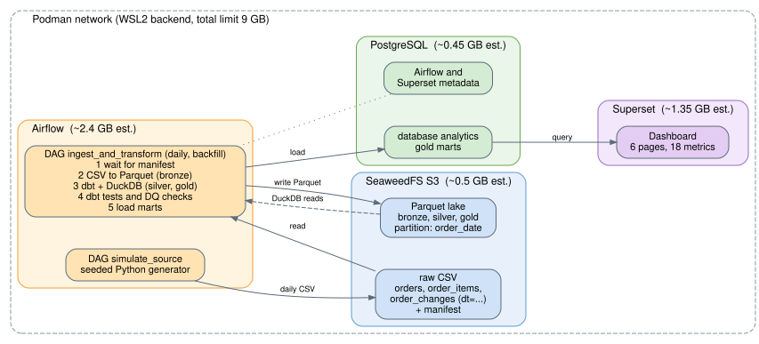

# Just Fast Food: sales analytics pipeline

Bootcamp final project (Dibimbing, data engineering, individual): end-to-end sales analytics for a
fictional fast-food chain on generated data. One daily batch pipeline carries CSV files from S3-compatible
storage to Metabase dashboards, keeps a replayable lake, and documents what was measured instead of what
was hoped.

- Design, decisions and the window numbers: `docs/pipeline-design.md`
- What was measured, task by task: `docs/verification/`
- Demo storyline and the one-day procedure: `docs/demo-script.md`
- Security posture and scan results: `docs/security.md`

## Architecture (as built)



Six long-running containers on one Podman machine, plus three one-shot helpers (`postgres-ro`,
`seaweedfs-init`, `airflow-init`) and the Metabase setup script that runs from the host:

| Service | Image | Role | Hard limit |
|---|---|---|---|
| `postgres` | `postgres:18.4` | Airflow metadata, Metabase app database, `analytics` marts | 600 MB |
| `seaweedfs` | `chrislusf/seaweedfs:4.52` | S3 API: raw CSV, bronze Parquet, published silver and gold | 600 MB |
| `airflow-scheduler` | `jff-airflow:3.3.2` | Scheduler and task execution (LocalExecutor), runs dbt and DuckDB | 1700 MB |
| `airflow-api-server` | `jff-airflow:3.3.2` | UI and REST API | 600 MB |
| `airflow-dag-processor` | `jff-airflow:3.3.2` | DAG parsing | 500 MB |
| `metabase` | `metabase:v0.65.3` | Dashboards, reading PostgreSQL as a read-only role | 1600 MB |

The whole stack is capped at 5600 MB against a 7.6 GiB WSL2 VM (no `.wslconfig`). Version choices and
their release dates are in `docs/versions.md`.

## Data flow

```
jff-gen  ->  jff-raw (CSV + manifest, manifest last)
             |
        ingest_bronze         all columns as text, one Parquet object per entity per file date
             |
        jff-lake/bronze       replay source: bronze is the source of truth
             |
        dbt + DuckDB          staging -> silver (dedup, payment mapping, refunds) -> gold (facts, dimensions)
             |
        jff.duckdb            named volume, single writer, disposable
             |
        load_marts            window delete + COPY into PostgreSQL, one transaction per table
             |
        PostgreSQL analytics  five marts, numerators and denominators only
             |
        Metabase              five pages, 17 cards; every ratio computed in card SQL
```

`publish_parquet` also mirrors silver and gold into `jff-lake/<layer>/<table>/order_date=.../part.parquet`.
The lake is derived; DuckDB and PostgreSQL are what the dashboard reads. Layout details: `docs/lake-layout.md`.

## Run it on Windows with Podman (the only tested path)

Tested on Windows 11 Home with Podman 6.1.4 (rootful machine, WSL2 backend) and `podman compose` through
`podman-compose` 1.6.0. Nothing else has been run.

Prerequisites: Podman with a WSL2 machine, a `python` on PATH (the host has 3.15.1; the containers and CI
use 3.12), and about 6 GB of free memory for the stack. `podman machine list` can report 2 GiB of memory
while the VM really has about 7.6 GiB; `podman machine ssh free -m` shows the actual total (about 7.8 GB).

```
git clone https://github.com/ivansurachman/just-fast-food-end-to-end-sales-analytics-pipeline.git
cd just-fast-food-end-to-end-sales-analytics-pipeline

# 1. Python first: gen_env.py is standard library only. It writes .env with LF line endings and picks
#    the Postgres host port for the machine (5432 when free, 5433 when a native PostgreSQL already
#    listens there); --postgres-port overrides the choice. Do not edit .env with a tool that rewrites
#    line endings: an editor that saves CRLF, or `Set-Content -NoNewline`, joins every line into one.
python tools/gen_env.py

# 2. Build and start
podman compose build --no-cache
podman compose up -d
podman compose ps                       # wait for healthy

# 3. Dimensions once, then seven fact days, inside the scheduler. `podman compose exec` takes the
#    service name, so the container name never appears; if you started the stack with `-p <name>`,
#    add the same `-p <name>` to every `podman compose` command.
podman compose exec -T airflow-scheduler /opt/venvs/jff/bin/jff-gen dim all \
    --out s3://jff-raw --s3-endpoint http://seaweedfs:8333
podman compose exec -T airflow-scheduler /opt/venvs/jff/bin/jff-gen generate \
    --start 2026-10-01 --end 2026-10-07 --scale 0.02 \
    --out s3://jff-raw --s3-endpoint http://seaweedfs:8333

# 4. Run those seven days and wait for them. The script unpauses the DAG, creates the backfill, polls
#    every 15 seconds until every run in the range is finished (45 minutes at most), and only then
#    pauses the DAG. Pausing earlier stops the scheduler mid-backfill without an error.
python tools/run_backfill.py --from-date 2026-10-01 --to-date 2026-10-07

# 5. Dashboards. setup.py stops with "run the backfill first" when the marts are empty, and runs every
#    card after creating it.
python dashboards/setup.py
```

Then open `http://localhost:3000` (Metabase, the admin from `.env`), `http://localhost:8080` (Airflow) and
`http://127.0.0.1:8888/buckets/` (the SeaweedFS file browser).

The seven-day quick start exercises the flow, not the capacity: it proves that a day turns into rows on a
dashboard. The capacity numbers — backfill durations, memory per container, row counts — are in
`docs/verification/T04-marts.md`, `T05-parquet.md` and section 14 of `docs/pipeline-design.md`.

`airflow dags pause` and `airflow dags unpause` print the status from **before** the change; the current
state is in `airflow dags details jff_daily` (`is_paused`).

Every step above ran in the T07 clean-room on 2026-11-23; the order is the corrected one, because that
run needed two attempts — the dimensions were missing at first, and the DAG boundary had to match the
days that exist. Report: `docs/verification/T07-hardening.md` section 1.

### Run one new day

The full procedure, including the two orders that fail silently, is in `docs/demo-script.md`. In short:
generate the day, extend `end_date` so the window covers it, unpause, then trigger. `airflow backfill create`
is the path that runs the tasks; `airflow dags trigger --logical-date` against a day outside the window
creates a run with no task instances that is finalised `success` in milliseconds (T07 section 7).

## Other platforms

**Expected to work, not tested here.** The compose file avoids Podman-only keys except `mem_limit`, which
Docker Compose also understands.

| Platform | Known difference |
|---|---|
| Docker Desktop / Engine | `podman compose` must be replaced by `docker compose`; the provider is the only change. `mem_limit` works in Compose v2. Named volumes become Docker volumes |
| Linux | Rootless Podman typically cannot bind-mount the code with the UID the Airflow image uses (50000); use rootful Podman or `:U` on the mounts. Ports stay loopback |
| macOS | Same as Docker on Apple Silicon: the Airflow image is amd64, so it runs under emulation and is slow. Not tested |

## The DAG

`jff_daily`, schedule `@daily`, `catchup=True`, `max_active_runs=1` (DuckDB allows one writer), one run per
generator file date, bounded by `start_date`/`end_date` in `dags/jff_daily.py`.

| # | Task | What it does | Why a re-run is safe |
|---|---|---|---|
| 1 | `wait_manifest` | Sensor (reschedule) on `_manifests/dt={ds}/manifest.json` | Read-only |
| 2 | `ingest_bronze` | Day's CSV to Parquet in `bronze/.../source_file_date={ds}/` | Same path, same bytes |
| 3 | `check_bronze` | Raw row counts vs bronze, manifest rows vs bronze | Read-only |
| 4 | `dbt_run` | Seed + silver/gold for `[ds-10, ds]` | `delete+insert` on the window |
| 5 | `dbt_test` | Generic and singular tests, including the lookback guard | Read-only |
| 6 | `load_marts` | Window replaced in PostgreSQL, one transaction per table | `DELETE` then `COPY` in one transaction |
| 7 | `publish_parquet` | Window mirrored to the lake | Prefix delete then write |

## Reprocessing window

A file for day D holds that day's orders plus the previous day's late orders, and a refund appears in the
file of the day it happens for an order up to 8 days old (generator config `refund_max_lag_days: 7` plus a
spill of up to 10 hours). A run for `ds = D` can therefore change order-date partitions in `[D-10, D]`.

The window is fixed at **10 days** (`LOOKBACK_DAYS`) rather than computed per run, and a singular dbt test
fails the pipeline if any change reaches its order later than the window, turning a silent correctness bug
into a loud failure (`docs/pipeline-design.md` section 6).

Silver for a partition X reads bronze file dates X and X+1, and every order_changes file from X up to the
newest that exists, bounded below by the window and not above by the run date. That is what makes a
re-run of an older date reproduce the same partition after new files arrived (T04 finding, 2026-11-21).

## Injected defects and how each is detected

`jff-gen` injects defects on purpose; silver flags them and the flags are compared with the manifest in
`docs/verification/T03-dbt.md` section 3 (three days, 2026-10-03 .. 2026-10-05):

| Defect | Silver rule | Flag | Manifest vs flag |
|---|---|---|---|
| duplicate_orders | one row per `order_id`, earliest file | `dup_order` | 33 vs 33 |
| duplicate_item_rows | one row per `(order_id, line_no)` | `dup_item` | 75 vs 75 |
| payment_null | `unknown` | `payment_null` | 32 vs 32 |
| payment_variant | canonical labels through the `payment_method_map` seed | `payment_variant` | 25 vs 25 |
| platform_ref_null | kept, online channels only | `platform_ref_null` | 28 vs 28 |
| gross_mismatch | gross recomputed from the lines | `gross_mismatch` | 31 vs 31 |
| unknown_menu_item | mapped to the `UNKNOWN` menu member | `unknown_item` | 22 vs 22 |
| late arrival | `source_file_date > order_date` | `late_arrival` | not one-to-one, explained in T03 |
| missing branch-day | branch spine from `dim_branch.open_date` | row in `fact_branch_day` with `orders_received = 0` | 9 missing = 9 `dropped_branch_ids` (T06 section 2) |

`docs/verification/T02-bronze.md` covers the ingest side: every defect survives into bronze unchanged,
which is the point of reading all columns as text.

## Metrics and dashboard

18 metrics are named in `docs/data-model.md`. **15 are implemented**: all 11 P1 (M1, M2, M3, M4, M6, M7,
M8, M10, M12, M15, M17) plus four P2 that needed no new gold table (M5 refund rate, M11 peak-hour load,
M13 item gross margin, M16 promo AOV lift). **17 cards on 5 pages** (`docs/verification/T06-p1.md`).

| Page | Cards | Metrics |
|---|---|---|
| Sales overview | 7 | M1, M2, M3, M4, M5, plus orders by channel and top 10 branches |
| Channel and branch | 3 | M6, M7, M8 |
| Operations | 3 | M10, M11, M17 |
| Menu | 2 | M12, M13 |
| Promo | 2 | M15, M16 |

Screenshots: `docs/slides/img/dashboard-sales-overview.png`, `dashboard-channel-branch.png`,
`dashboard-operations.png`, `dashboard-menu.png`, `dashboard-promo.png` (taken 2026-11-23 at a 1056 px
window, so half-width tables clip their last column; see T06 section 8.5).

Deferred, with reasons: **M9** needs a rolling 28-day peer median per branch and region/outlet type;
**M14** is an order-level beverage attach measure that no current gold table carries; **M18** needs
`fact_dq_daily`, which does not exist.

Every card returns the same rows through the API as its `.sql` file run in `psql` (17 of 17, T06 section 3),
and the dashboard date filter is a fixed `order_date >= date '2026-10-01'` in all of them (`docs/later.md`).

## Measured resources

All numbers are from the reports named in the last column; none is an estimate.

| Reading | Value | Source |
|---|---|---|
| Stack hard limit | 5600 MB, six long-running containers | design section 2 |
| Memory with the window loaded (postgres / seaweedfs / metabase / api-server / scheduler / dag-processor) | 165 MB / 326.8 MB / 1.357 GB / 331.8 MB / 1.077 GB / 205.8 MB | T06 section 6 |
| 45-day backfill through the DAG | 23.4 min, peak scheduler `anon` 1344 MiB | T04 |
| 46-run backfill (T05 window) | 24.8 min, peak scheduler `anon` 1122 MB | T05 section 6 |
| One day end to end, all seven tasks | 42.3 s, peak `anon` 661.4 MB (sampled every 5 s) | T06 section 5 |
| Seven-day clean-room backfill | 3.5 min for seven runs, 1.8 min to healthy | T07 section 1 |
| Publish of the whole window with the CLI | 10.5 s, peak `anon` 539.6 MB | T05 section 6 |
| Window rows, objects and sizes | see `docs/pipeline-design.md` section 14 | T07 section 8 |

## Decisions

| # | Decision | Choice and why | Rejected |
|---|---|---|---|
| D1 | Where silver and gold are computed | DuckDB file plus dbt incremental `delete+insert`; Parquet published from it | Parquet as the primary store: no partition-level incremental in dbt-duckdb, custom delete-prefix code |
| D2 | Reprocessing window | Fixed 10 days plus a guard test | Dynamic detection: more precise, one more failure mode on the critical path |
| D3 | Airflow line | 3.3.2 (Airflow 3, FabAuthManager), python 3.12 | Airflow 2.11.x: one process fewer, but no reason to fall back after the measurements |
| D4 | Postgres layout | One instance, three databases (`airflow`, `metabase`, `analytics`) | One database per tool: three times the memory for no benefit |
| D5 | Demo dataset | See section 14 of the design | A full-scale day for everything: 10x the rows for the same slides |
| D6 | Generator in Airflow | CLI (`jff-gen`) on the host or in the scheduler | A `simulate_source` DAG: more moving parts before the deadline |

## Limitations

Every limitation below has a report behind it.

- **Single-writer DuckDB.** One DAG run at a time (`max_active_runs=1`) and one `duckdb_writer` pool slot.
  Two concurrent writers would corrupt the file (design section 4).
- **Synthetic data.** The generator's assumptions are the world: commission rates are placeholder
  percentages, not platform contracts, and every insight inherits the generator's behaviour
  (`docs/data-profile.md`).
- **The newest day is provisional.** Its late orders and refunds arrive in the next day's file, so its
  partition is rewritten on the next run (T04).
- **`fact_branch_day` starts at the first file date.** 2026-09-30 has orders (late arrivals of the 10-01
  file) but no file of its own, so it is not a coverage day (T06 section 2).
- **Orphan refunds before the window.** 163 refund rows reference orders dated 2026-09-23 .. 2026-09-30,
  before the dataset starts, so they do not attach to an order; the generator writes refunds for orders it
  never produced. With three rows that reference dropped branch-days the orphan count is 166
  (`docs/verification/T04-marts.md`).
- **A lake partition can outlive its date.** A partition is deleted only when its own date is published
  again; a date that disappears from DuckDB and is never republished keeps its object (T05 section 5).
- **The dashboard date filter is a fixed date** in all 17 cards; a different dataset means editing them or
  adding a Metabase parameter (`docs/later.md`).
- **Adding a mart to an existing dataset needs one wide `load_marts --lookback-days` run**; the daily window
  only rewrites its own 10 days (T06, the repair of 2026-09-30).
- **Two stacks cannot run at once.** The hard limits sum to 5600 MB in a 7.6 GiB VM; the clean-room had to
  stop the demo stack first (T07 section 1).
- **Host port 5432 is often taken.** A native Windows PostgreSQL holds it on Ivan's machine, so
  `tools/gen_env.py` writes `POSTGRES_HOST_PORT=5433` when 5432 is listening (`--postgres-port` forces a
  value; design section 9).
- **The Podman machine is rootful** and there are **no backups** and **no TLS**; `docs/security.md` lists
  what that does and does not expose.
- **CI does not prove the pipeline works end to end.** The GitHub workflow runs lint, types and unit tests;
  the SeaweedFS tests skip themselves there. End-to-end proof is the clean-room and the T04-T06 reports
  (T07 sections 1 and 5).

## Tests

Three environments, one supported command list each; the containers run the pipeline and do not carry
pytest. Versions: `pipelines/constraints.txt` (pipeline code) and `generator/constraints.txt` +
`generator/constraints-dev.txt` (generator).

Pipeline code, from the repo root:

```
python -m pip install -r requirements-dev.txt
python -m ruff check .
python -m ruff format --check .
python -m mypy
python -m pytest -q
```

The SeaweedFS cases skip unless `S3_ACCESS_KEY`, `S3_SECRET_KEY` and `JFF_S3_ENDPOINT` are exported; with
the stack up, export them from `.env` and the same command runs them too.

Generator, from `generator/`:

```
python -m pip install -c constraints.txt -c constraints-dev.txt -e ".[dev,s3test]"
python -m pytest -q
python -m ruff check .
python -m ruff format --check .
python -m mypy src tests
```

What CI runs: `.github/workflows/ci.yml`, two jobs (pipeline code; generator) on ubuntu-24.04 with Python
3.12, each installing its own pin file. CI checks lint, types and unit tests; the tests that need SeaweedFS
skip themselves there.

Host Python on Ivan's machine is 3.15.1; the containers and CI use 3.12.

## Repo layout

```
dags/                 the jff_daily DAG
pipelines/            ingest_bronze, check_bronze, load_marts, publish_parquet, manifest helpers, SQL
dbt/                  staging, silver, gold and mart models, seeds, tests, profiles.yml
dashboards/           setup.py and one SQL file per card, one folder per page
generator/            the seeded synthetic data generator (its own venv and constraints)
infra/                Postgres roles, SeaweedFS entrypoints, Airflow init and install scripts
tools/                gen_env.py, check_secrets.py
docs/                 design, data model and dictionary, versions, security, demo script, verification
sample-data/          seven days at --scale 0.02, byte-identical to a Linux run
compose.yaml          the six services and three one-shot helpers
Containerfile         the Airflow image (generator venv, dbt venv, DuckDB extensions)
```
