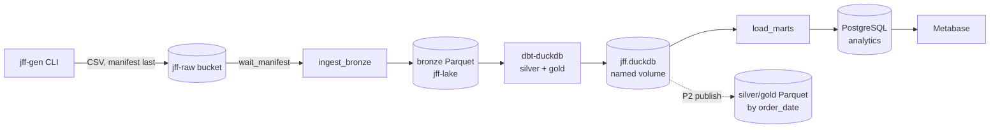

# Pipeline design (Phase 3)

Status: **draft for approval, 17 Nov 2026**. Nothing in this document has been run. Every number marked *est.* is an estimate until measured on 18 Nov. Items marked **verify** depend on a version or a Podman behaviour that has not been checked.

Serves checkpoint: **22 Nov, Mentoring 2 (pipeline runs end to end)**. Anything not needed for that goes to the "later" list at the end.

## 1. Scope

One daily batch pipeline, `jff_daily`, that takes the generator's CSV files from S3-compatible storage to Metabase dashboards:

In scope: ingest, bronze, silver, gold, marts, DQ checks, backfill, Metabase P1 pages. Out of scope: see section 11.

## 2. Components and memory budget

Hard budget: stack limits sum to **5.6 GB**. The target was a 9 GB WSL2 cap via `.wslconfig`; on Ivan's machine no `.wslconfig` exists, so the VM has the WSL2 default of about 7.6 GiB (measured in T00). The remaining roughly 2 GiB (3.4 GB with the 9 GB cap) is for the WSL kernel, page cache, the Podman machine and ad-hoc `jff-gen` runs. A `.wslconfig` with `memory=9GB` is recommended, not required. All values are design estimates; 18 Nov replaces them with `podman stats` readings.

| Container | Role | Typical (est.) | Hard limit |
|---|---|---|---|
| postgres | Airflow metadata, Metabase app DB, `analytics` marts (one instance, three databases) | 0.45 GB | 0.6 GB |
| seaweedfs | S3 API, single node | 0.5 GB | 0.6 GB |
| airflow-scheduler | Scheduler and task execution (LocalExecutor), runs DuckDB | 1.4 GB | 1.7 GB |
| airflow-api-server | UI and API | 0.6 GB | 0.8 GB |
| airflow-dag-processor | DAG parsing (Airflow 3 only) | 0.4 GB | 0.5 GB |
| metabase | JVM with `-Xmx` capped | 1.0 GB | 1.4 GB |
| **Total** | | **~4.4 GB** | **5.6 GB** |

Rules that keep the budget real:

- DuckDB runs with `memory_limit='1GB'`, `threads=2`, and a `temp_directory` on a named volume. Without the limit DuckDB takes up to 80% of the container's visible RAM.
- The scheduler limit (1.7 GB) must cover the Airflow process plus DuckDB's 1 GB. If a task is OOM-killed, lower `threads` before raising the limit.
- If Airflow 3 does not fit, fall back to Airflow 2.11.x (one fewer process). Decide on 18 Nov from measured numbers, not from this table.
- A one-shot `airflow-init` container runs migrations and exits. It is not counted.

## 3. Storage layout

| Location | Content | Writer |
|---|---|---|
| `s3://jff-raw/<entity>/dt=YYYY-MM-DD/<entity>.csv` | Generator output, never edited by the pipeline | `jff-gen` |
| `s3://jff-raw/_manifests/dt=.../manifest.json` | Day-complete marker, written last | `jff-gen` |
| `s3://jff-raw/dimensions/*.csv` | Dimension tables | `jff-gen dim` |
| `s3://jff-lake/bronze/<entity>/source_file_date=YYYY-MM-DD/<entity>.parquet` | Raw rows as text plus `source_file_date`, `_source_file` | `ingest_bronze` |
| `s3://jff-lake/silver/...`, `gold/...` | P2: Parquet published per `order_date` | `publish_parquet` |
| `jff.duckdb` on named volume `jff_duckdb` | dbt silver and gold tables | dbt |
| PostgreSQL `analytics` | Dashboard marts | `load_marts` |

Bronze is **the source of truth for replay**. `jff.duckdb` is disposable: deleting it and re-running a backfill rebuilds everything. That is the recovery story to give the mentor.

Bronze reads every column as text (`all_varchar`), so a dirty value can never fail ingest. Casting happens in silver.

## 4. Decision D1: where silver and gold are computed

This is the one place the design goes beyond the literal wording of the approved architecture ("Parquet partitioned by `order_date`, DuckDB + dbt"). The layer table in `data-model.md` is marked provisional, so it is settled here.

| Option | How | Cost |
|---|---|---|
| **A (recommended)** | dbt-duckdb `incremental` models with `delete+insert` on `order_date`, in a persistent DuckDB file. Parquet by `order_date` is *published* from it as a P2 task | Silver Parquet is a copy, not the primary store. If publish breaks, the pipeline still runs |
| B | Parquet is primary. dbt `external` materialization, or a custom partition-overwrite step | dbt-duckdb external models rewrite the whole output and, as far as I know, have no partition-level incremental (**verify**). Partition overwrite on S3 needs custom delete-prefix code. Roughly one extra day of risk |

Why A: the approved choice of DuckDB + dbt is kept, the refund rewrite maps to a well-trodden dbt strategy, and the lake still exists (bronze Parquet on S3, replayable). Honest weakness: the Parquet-by-`order_date` layer is not on the critical path for 22 Nov. The "Partition & Clustering" rubric item is covered by the P2 publish task and by Postgres indexes. If the publish task is cut, say so in the slides instead of claiming it.

DuckDB allows one writer. Enforced by `max_active_runs=1` on the DAG and an Airflow pool `duckdb_writer` with 1 slot. The file lives on a **named volume**, not a bind mount from `C:\` (see section 9).

## 5. DAG `jff_daily`

Schedule: daily, `ds` = the generator file date. Tasks:

| # | Task | What it does | Idempotent because |
|---|---|---|---|
| 1 | `wait_manifest` | Sensor (reschedule mode) on `_manifests/dt={ds}/manifest.json` | Read-only |
| 2 | `ingest_bronze` | DuckDB reads the day's CSVs from `jff-raw`, writes one Parquet file per entity to `bronze/.../source_file_date={ds}/` | Same object path, overwritten with the same content |
| 3 | `check_bronze` | Row counts raw vs bronze must match; manifest `rows` must equal the bronze counts | Read-only |
| 4 | `dbt_run` | `dbt run --vars '{run_date: {ds}, lookback_days: 10}'` | `delete+insert` on the window |
| 5 | `dbt_test` | dbt generic and singular tests (section 7) | Read-only |
| 6 | `load_marts` | Replace window rows in each mart table, one transaction per table | `DELETE` window then `COPY`, same transaction |
| 7 | `publish_parquet` | **P2.** Delete the partition prefix, write the partition | Prefix delete then write |

Dimensions load as a separate small DAG task group at the start of the first run (full refresh, tiny tables).

Backfill: `catchup=True`, one run per date, in order. Rewriting 11 partitions per run is wasteful at 45 days (about 500 partition writes), but at scale 0.1 each partition is about 12k orders. Cheap enough, and simpler than a special backfill mode.

## 6. Reprocessing window

Facts from the generator (config and `data-profile.md`):

- A file for day D holds orders of day D and late orders of day D-1.
- A refund appears in the file of the day it happens, for an order up to 8 days old in the 45-day profile (config `refund_max_lag_days: 7`, plus a spill of up to 10 hours).
- Order date is the local date of `order_ts`. It is **not** the file date.

So a run for `ds = D` can change partitions `order_date` in `[D-10, D]`. Ten days is the observed maximum of 8 plus a margin of 2.

**Decision D2 (recommended): fixed window `lookback_days = 10` with a guard test**, instead of computing affected dates dynamically. Dynamic detection is more precise but adds a join and a failure mode on the critical path. The guard: a singular dbt test fails the run if any `order_changes` row references an order older than `run_date - lookback_days`. That turns a silent correctness bug into a loud failure.

Silver rebuild for each partition X in the window reads:

- orders and items from bronze file dates `X` and `X+1` (late arrivals), clipped to `run_date`
- order_changes from bronze file dates `X` to `run_date`, joined on `order_id`

All reads are pruned by `source_file_date`, so a run never scans all history.

A partition for day D is rewritten again on the run for D+1, because late orders for D arrive in the file of D+1. Dashboards therefore show yesterday's number as provisional until the next run. Say that on the slide; it is a real property, not a bug.

## 7. Transformations and data quality

Silver rules, one per injected defect:

| Defect | Silver rule | Flag in `dq_flags` |
|---|---|---|
| duplicate_orders | Keep one row per `order_id`, earliest `source_file_date` | `dup_order` |
| duplicate_item_rows | Keep one row per `(order_id, line_no)` | `dup_item` |
| payment_variant | Map to canonical labels via a dbt seed | `payment_variant` |
| payment_null | `unknown` | `payment_null` |
| platform_ref_null | Keep, online channels only | `platform_ref_null` |
| gross_mismatch | Recompute gross from items | `gross_mismatch` |
| unknown_menu_item | Map to `UNKNOWN` member | `unknown_item` |
| late arrival | `source_file_date > order_date` | `late_arrival` |
| missing branch-day | Branch spine from `dim_branch.open_date` minus received days | row in `fact_branch_day` |

"Quarantine" for 22 Nov means flagged rows kept in the facts, not a separate rejected-rows table. The generator produces no rows that must be rejected. A real quarantine table is P2 with M18.

dbt tests that block `load_marts`: `unique` and `not_null` on keys, `relationships` from facts to dimensions, `accepted_values` on status and channel, row-count reconciliation (bronze distinct orders equals silver orders), `gross_amount` equals the sum of line amounts, and the lookback guard.

P2: a reconciliation test that compares flag counts against `manifest.injected` (the "9 of 9" story). The manifest is used only by tests, never by transformations.

## 8. Gold and marts

Gold is as in `data-model.md`. Incremental facts: `fact_order`, `fact_order_item`, `fact_branch_day` (window delete+insert on `order_date`). Full-refresh dimensions: `dim_date`, `dim_branch`, `dim_channel`, `dim_promo`, `dim_menu_item`.

Marts keep numerators and denominators, never finished ratios, so Metabase cannot average a rate wrongly.

| Mart (Postgres) | Grain | Metrics | Priority |
|---|---|---|---|
| `mart_sales_day_branch_channel` | date, branch, channel | M1, M2, M3, M4, M6, M7, M8 | P1 |
| `mart_promo_day` | date, promo, channel | M15 (M16 later) | P1 |
| `mart_hourly` | date, branch, hour | M10 | P1 |
| `mart_item_day` | date, menu item | M12 (M13, M14 later) | P1 |
| `mart_branch_coverage` | date, branch | M17 | P1 |
| P2 marts | | M5, M9, M11, M13, M14, M16, M18 | P2 |

Row counts at 45 days, scale 0.1, are in the tens of thousands per mart (**est.**, measured on 21 Nov). Index on `order_date` for every mart. Metabase app database is a separate Postgres database, not H2.

`load_marts` uses `psycopg` with `COPY` from a DuckDB Arrow result. The DuckDB `postgres` extension is the alternative; it needs an extension download at runtime (**verify**), so it is not the default.

## 9. Podman on Windows Home: what behaves differently

All **verify** until the smoke test on Ivan's machine passes.

- **Memory limits may be ignored.** Rootless Podman needs cgroup v2 with the memory controller delegated. In a WSL2 machine this depends on systemd and the delegation setup. Check by running a container with a low limit and reading `podman stats`. If limits are not enforced, the "explicit limits in compose files" claim is false on Windows and must be stated as such.
- **Named volumes for databases.** Postgres, SeaweedFS and `jff.duckdb` must live on named volumes inside the WSL filesystem. Bind mounts from `C:\...` go through a slow cross-OS filesystem and break file permissions and locking.
- **Bind mounts only for code.** `dags/`, `dbt/` and `generator/` as relative bind mounts. Keep `.gitattributes` LF so shell scripts work inside containers.
- **Rootless UID mapping.** The Airflow image runs as UID 50000. Writable named volumes may need `user:` or `userns_mode` settings (**verify**).
- **Compose provider.** `podman compose` delegates to `docker-compose` or `podman-compose`. They differ on `deploy.resources` versus `mem_limit`. Pin one provider and document it.
- **Postgres host port.** The mapping is `127.0.0.1:${POSTGRES_HOST_PORT:-5432}:5432`, and `.env.example`
  sets `POSTGRES_HOST_PORT=5432`. On a machine where a native server already listens on 5432 (Ivan has
  PostgreSQL 18 as a Windows service) set `POSTGRES_HOST_PORT=5433` in `.env`; nothing inside the
  pipeline uses the host port, Airflow and Metabase reach Postgres as `postgres:5432`.
- **Extensions offline.** DuckDB `httpfs` and `parquet` extensions are installed at image build time, so the demo does not need internet.
- **Secrets.** `.env` is gitignored; `.env.example` is committed. No credentials in compose files.

Generator to S3 needs one code change first: a `--s3-endpoint` option and path-style addressing for SeaweedFS (`storage_options` with `endpoint_url` and `addressing_style=path`). On S3 an object appears only when its writer closes it, so the "manifest last" rule still holds.

## 10. Plan to 22 Nov

| Date | Target | Done when |
|---|---|---|
| 17 | This document approved. **Smoke test on Windows now** (section 12) | Approval given; smoke test results recorded |
| 18 | Compose up (postgres, seaweedfs, airflow), memory measured, `jff-gen` writes to S3 | `podman stats` table filled; one day visible in `jff-raw` |
| 19 | `ingest_bronze`, `check_bronze`, DAG skeleton | Backfill of 3 days gives identical bronze on re-run |
| 20 | dbt silver and gold, tests | `dbt test` green on the 45-day window |
| 21 | `load_marts`, Metabase connected, 3 P1 pages | Three pages render from Postgres |
| 22 | Full 45-day backfill, run end to end, demo rehearsal | One clean daily run from sensor to dashboard |

**Go/no-go on the evening of 18 Nov.** If Airflow does not start inside its memory limit, switch to Airflow 2.11.x. If memory limits are not enforced, record that and continue; do not spend a day on cgroup configuration.

**Cut order if behind:** P2 metrics, Metabase pages beyond three, `fact_dq_daily` and `fact_branch_day` (M17 then moves to P2), `publish_parquet`, DAG for the generator.

## 11. Later list

Iceberg, ClickHouse, monitoring tooling, Telegram alerting, platform settlement as a second source, dynamic branches, TikTok voucher, customer dimension, Metabase as code, full-year scale test, generator DAG (`simulate_source`), dynamic affected-date detection, Postgres table partitioning.

## 12. Smoke test (about 30 minutes, no project code)

1. `podman machine` uses the WSL provider; `.wslconfig` has `memory=9GB`; `wsl --shutdown` applied.
2. Run `podman run --rm --memory=64m docker.io/library/alpine sh -c "..."` that allocates beyond 64 MB. It must be killed. If not, limits are not enforced.
3. Start a Postgres container on a named volume, restart it, confirm data survives.
4. Record `podman version`, `podman compose version` and which provider it uses.
5. Install the generator with `constraints.txt` on Windows, run `pytest` and `jff-gen generate --date 2026-10-05 --scale 0.02 --out ./tmp`, and compare the output with `sample-data/` (byte identity is expected only for Linux containers).

## 13. Open decisions

| ID | Decision | Recommendation |
|---|---|---|
| D1 | Silver/gold compute store | A: DuckDB file plus dbt incremental, Parquet published as P2 |
| D2 | Reprocessing window | Fixed 10 days plus guard test |
| D3 | Airflow line | 3.x pinned to an exact patch tag older than two weeks (**verify** tag on 18 Nov), fall back to 2.11.x |
| D4 | Postgres layout | One instance, three databases |
| D5 | Demo dataset | 45 days at scale 0.1; one full-scale day only to measure RAM |
| D6 | Generator inside Airflow | Defer; CLI for 22 Nov |
